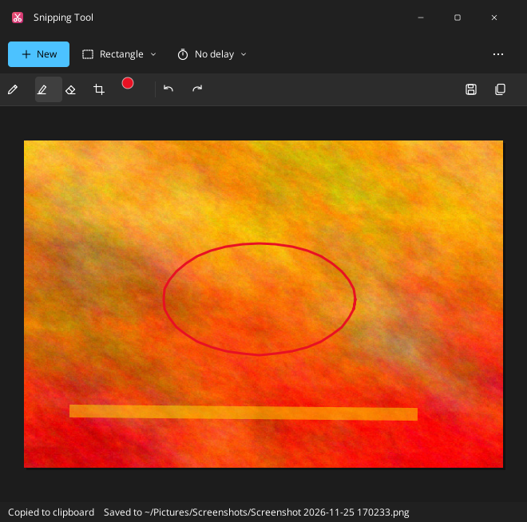
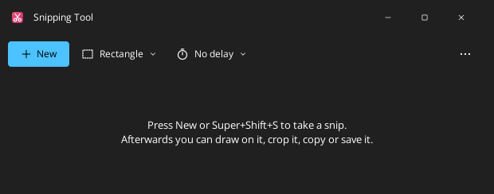

# pi-snip

A Windows 11 Snipping Tool style Snipping Tool app for the Raspberry Pi (built for the Pi 5, works on other Pis running Raspberry Pi OS). Native GTK app with the Windows 11 dark look, made to match [pi-explorer](https://github.com/wvfouram/pi-explorer) and [pi-taskmgr](https://github.com/wvfouram/pi-taskmgr).



## Features

- **Super+Shift+S** anywhere to snip, just like Windows
- **Rectangle**, **Freeform** and **Full screen** snips. The screen freezes and dims while you pick the area
- **Delay** of 3, 5 or 10 seconds to capture menus
- **Mark up** the snip with a ballpoint pen (8 colors, adjustable size), highlighter and eraser
- **Crop**, undo and redo
- Every snip is **copied to the clipboard** and **saved automatically** to Pictures/Screenshots (both can be turned off)
- Save as PNG or JPG anywhere you like
- Works on the Pi's normal Wayland desktop (uses grim) and on X11



## Install

In a terminal on the Pi (as your normal user, not with sudo):

```
git clone https://github.com/wvfouram/pi-snip.git && bash pi-snip/install.sh
```

Then open **Snipping Tool** from the menu, or run `pi-snip`.

To update later:

```
cd ~/pi-snip && git pull && bash install.sh
```

## Keyboard shortcuts

| Keys | Action |
|---|---|
| Super+Shift+S | New snip from anywhere |
| Ctrl+N | New snip |
| Ctrl+C | Copy |
| Ctrl+S | Save as |
| Ctrl+Z / Ctrl+Y | Undo / Redo |
| Enter / Esc | Apply / cancel crop |

## Uninstall

```
bash pi-snip/uninstall.sh
```

## License

MIT
